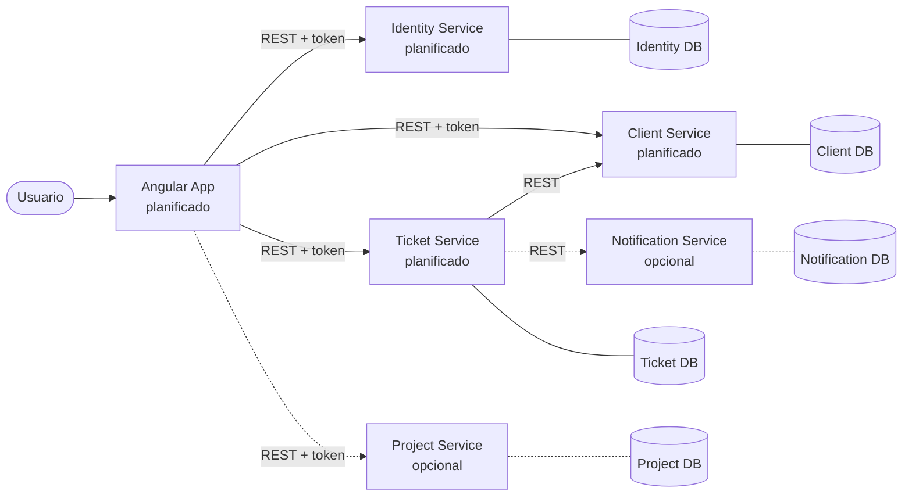

# ST ServiceHub

> Plataforma educativa de gestión de servicios y tickets construida con arquitectura de microservicios.
> Proyecto integrador del curso **Full Stack Microservices Lab** de **STDevSec Academy**.

**Construir. Entender. Defender.**

> [!IMPORTANT]
> **Estado: bootstrap.** El repositorio solo contiene la estructura y la documentación inicial.
> **Ningún servicio ni el frontend están implementados todavía.** Todo lo que se describe aquí como
> arquitectura es el diseño **planificado**.

---

## Tabla de contenido

1. [Descripción](#1-descripción)
2. [Relación con STDevSec Academy](#2-relación-con-stdevsec-academy)
3. [Objetivos educativos](#3-objetivos-educativos)
4. [Problema de negocio](#4-problema-de-negocio)
5. [Stack previsto](#5-stack-previsto)
6. [Arquitectura general](#6-arquitectura-general)
7. [Microservicios](#7-microservicios)
8. [Estructura del repositorio](#8-estructura-del-repositorio)
9. [Requisitos para participar](#9-requisitos-para-participar)
10. [Metodología de trabajo](#10-metodología-de-trabajo)
11. [Flujo de contribución](#11-flujo-de-contribución)
12. [Convenciones de ramas y commits](#12-convenciones-de-ramas-y-commits)
13. [Estado actual del proyecto](#13-estado-actual-del-proyecto)
14. [Roadmap](#14-roadmap)
15. [Información institucional](#15-información-institucional)

---

## 1. Descripción

**ST ServiceHub** es una plataforma para que una organización de servicios tecnológicos registre a sus
clientes, reciba solicitudes de soporte en forma de **tickets** y haga seguimiento de su atención
(estado, prioridad, asignación y comentarios). De forma opcional, permitirá agrupar el trabajo en
**proyectos** y enviar **notificaciones**.

El sistema se construye como un **monorepo académico** que contiene varios microservicios
independientes y una aplicación web Angular.

## 2. Relación con STDevSec Academy

ST ServiceHub es el proyecto integrador del curso **Full Stack Microservices Lab**, impartido por
**STDevSec Academy**, el programa formativo de **STDevSec — Servicios Tecnológicos Devsec**.

El curso dura cuatro semanas:

- **Semana 1:** inducción (herramientas, metodología, arquitectura).
- **Semanas 2, 3 y 4:** desarrollo colaborativo de ST ServiceHub.

## 3. Objetivos educativos

Al finalizar el proyecto, cada estudiante habrá practicado:

- Diseño y límites de **microservicios** (propiedad de datos, contratos, despliegue independiente).
- Desarrollo **Full Stack** con Spring Boot y Angular.
- Diseño de APIs **REST** documentadas con **OpenAPI**.
- **Seguridad** de aplicaciones: autenticación, autorización, validación y manejo de secretos.
- **Testing** automatizado en backend y frontend.
- Flujo profesional con **Git y GitHub**: Issues, ramas, Pull Requests y Code Review.
- Contenedores con **Docker** e integración continua con **Jenkins**.
- **Desarrollo asistido por IA** con responsabilidad y revisión humana.

## 4. Problema de negocio

Una empresa de servicios tecnológicos atiende a múltiples clientes. Hoy las solicitudes llegan por
canales dispersos (correo, mensajes, llamadas), sin trazabilidad, sin prioridades claras y sin un
responsable visible. Esto provoca:

- Solicitudes olvidadas o duplicadas.
- Falta de visibilidad sobre qué se está atendiendo y quién lo atiende.
- Dificultad para medir tiempos de respuesta.
- Acceso indebido a información de clientes.

ST ServiceHub centraliza esas solicitudes en tickets con un ciclo de vida definido, responsables
asignados y control de acceso por roles.

## 5. Stack previsto

> Las versiones exactas **están pendientes de confirmación** (ver [Decisiones pendientes](#decisiones-pendientes)).
> No se instalarán dependencias ni se fijarán versiones sin verificar compatibilidad.

| Área      | Tecnologías previstas |
|-----------|-----------------------|
| Backend   | Java LTS, Spring Boot, Spring Web, Spring Data JPA, Spring Security, Bean Validation, OpenAPI, Maven |
| Datos     | Base de datos relacional (motor por confirmar), una por servicio |
| Frontend  | Angular, TypeScript, Angular Router, HttpClient, Reactive Forms |
| DevOps    | Git, GitHub, Docker, Docker Compose, Jenkins |
| Método    | Spec-Driven Development, Vertical Slices, Clean Code, SOLID, PR + Code Review, CI, IA con revisión humana |

## 6. Arquitectura general

Arquitectura de microservicios con comunicación **REST** síncrona. Cada servicio es **dueño de sus datos**:
ningún servicio accede a la base de datos de otro.



Las líneas punteadas indican componentes **opcionales**. Un **API Gateway** no forma parte del diseño
inicial; solo se incorporará si se justifica mediante un ADR.

Más detalle en:

- [Visión general de la arquitectura](docs/architecture/overview.md)
- [Contexto del sistema](docs/architecture/system-context.md)
- [Límites de los servicios](docs/architecture/service-boundaries.md)
- [Registro de decisiones (ADR)](docs/decisions/README.md)

## 7. Microservicios

| Servicio | Carácter | Responsabilidad | Estado |
|----------|----------|-----------------|--------|
| `identity-service` | Obligatorio | Identidad, autenticación, roles y permisos | Planificado |
| `client-service` | Obligatorio | Gestión de clientes | Planificado |
| `ticket-service` | Obligatorio | Tickets, estados, prioridades, asignaciones y comentarios | Planificado |
| `project-service` | Opcional | Gestión de proyectos | Planificado (sujeto a número de estudiantes) |
| `notification-service` | Opcional | Notificaciones | Planificado (sujeto a número de estudiantes) |
| `angular-app` | Obligatorio | Interfaz web | Planificado |

## 8. Estructura del repositorio

```text
st-servicehub/
├── .github/                 # Plantillas de Issues y PR, CODEOWNERS
├── docs/
│   ├── architecture/        # Visión general, contexto y límites de servicios
│   ├── decisions/           # Architecture Decision Records (ADR)
│   ├── specs/               # Especificaciones de features (Spec-Driven Development)
│   ├── api/                 # Contratos OpenAPI
│   ├── audits/              # Auditorías del repositorio
│   └── learning/            # Guía del estudiante y política de IA
├── frontend/
│   └── angular-app/         # Aplicación Angular (por crear)
├── services/
│   ├── identity-service/    # (por crear)
│   ├── client-service/      # (por crear)
│   ├── ticket-service/      # (por crear)
│   ├── project-service/     # Opcional (por crear)
│   └── notification-service/# Opcional (por crear)
├── infrastructure/
│   ├── docker/              # Guías Docker comunes (cada servicio tendrá su Dockerfile)
│   ├── compose/             # Orquestación local
│   └── jenkins/             # Pipelines de CI
├── scripts/                 # Scripts de apoyo
├── .editorconfig  .gitattributes  .gitignore  .env.example
├── README.md  CONTRIBUTING.md  SECURITY.md  LICENSE-DECISION.md
```

Los directorios vacíos contienen un archivo `.gitkeep` únicamente para que Git los rastree.

## 9. Requisitos para participar

**Conocimientos:** Java y programación orientada a objetos, fundamentos de HTTP/REST, SQL básico,
TypeScript básico y Git básico.

**Herramientas** (las versiones se confirmarán durante la semana 1; ver
[decisiones técnicas pendientes](docs/architecture/technical-decisions-pending.md)):

- Git y una cuenta de GitHub con acceso al repositorio.
- JDK LTS.
- Maven (o el Maven Wrapper que incluirá cada servicio).
- Node.js LTS y npm.
- Angular CLI.
- Docker y Docker Compose.
- Un IDE (IntelliJ IDEA, VS Code u otro) que respete `.editorconfig`.

## 10. Metodología de trabajo

- **Spec-Driven Development:** toda funcionalidad sigue el ciclo
  **INTENT → SPEC → PLAN → TASKS → IMPLEMENT → VERIFY**. Ver [docs/specs](docs/specs/README.md).
- **Vertical Slice Development:** cada entrega atraviesa todas las capas necesarias
  (UI → API → dominio → persistencia → pruebas) para un caso de uso concreto.
- **Clean Code y SOLID.**
- **Pull Requests y Code Review** obligatorios para todo cambio en `main`.
- **Integración continua** con Jenkins (en preparación).
- **IA como asistente, con revisión humana.** Ver la [política de IA](docs/learning/ai-development-policy.md).

### Regla académica 2+1

Cada estudiante debe entregar:

- **Dos vertical slices completas y propias** (individuales) dentro de su equipo.
- **Una contribución transversal** (acordada entre equipos), por ejemplo: seguridad compartida,
  pipeline de CI, Docker Compose, contratos OpenAPI o pruebas de integración.

Cada contribución debe ser trazable:

```text
Issue → Spec → Branch → Commits → Tests → PR → Review → CI → Merge
```

Detalles en la [guía del estudiante](docs/learning/student-guide.md#cómo-cumplir-la-regla-21).

## 11. Flujo de contribución

1. Crear o asignarse un Issue.
2. Redactar la especificación.
3. Revisar los criterios de aceptación.
4. Crear una rama.
5. Implementar los cambios.
6. Ejecutar las pruebas.
7. Crear commits descriptivos.
8. Abrir un Pull Request.
9. Solicitar revisión.
10. Verificar la CI.
11. Integrar los cambios.

Guía completa en [CONTRIBUTING.md](CONTRIBUTING.md).

## 12. Convenciones de ramas y commits

**Ramas:**

```text
feature/<issue-id>-descripcion
fix/<issue-id>-descripcion
docs/<issue-id>-descripcion
test/<issue-id>-descripcion
```

**Commits** ([Conventional Commits](https://www.conventionalcommits.org/es/v1.0.0/)):

```text
feat(tickets): add ticket creation
fix(clients): validate email
test(identity): cover invalid credentials
docs(architecture): describe service boundaries
```

## 13. Estado actual del proyecto

| Componente | Estado |
|------------|--------|
| Estructura del repositorio | ✅ Creada |
| Documentación de arquitectura, ADR, plantillas y guías | ✅ Creada |
| Plantillas de Issues y Pull Requests | ✅ Creadas |
| Protección de la rama `main` | ✅ Aplicada (PR + 1 aprobación; sin checks de CI todavía) |
| Identity / Client / Ticket Service | ⏳ Planificado, sin código |
| Project / Notification Service | ⏳ Opcional, sin código |
| Angular App | ⏳ Planificado, sin código |
| Contratos OpenAPI | ⏳ Pendiente |
| Docker / Docker Compose | ⏳ Pendiente |
| Pipeline Jenkins | ⏳ Pendiente |

### Decisiones pendientes

Las decisiones técnicas (versiones de Java, Spring Boot, Angular y Node.js, motor de base de datos,
autenticación, autorización, contratos, versionado de APIs, pruebas y CI/CD) se analizan, con
alternativas y recomendación, en
[technical-decisions-pending.md](docs/architecture/technical-decisions-pending.md).

Otras decisiones organizativas pendientes:

- Responsables reales en `CODEOWNERS`.
- Licencia del repositorio (ver [LICENSE-DECISION.md](LICENSE-DECISION.md)).

La última auditoría del repositorio está en [docs/audits/bootstrap-audit.md](docs/audits/bootstrap-audit.md).

## 14. Roadmap

| Semana | Objetivo | Entregables esperados |
|--------|----------|-----------------------|
| **1 — Inducción técnica** | Herramientas, metodología y arquitectura | Entorno local listo, equipos formados, decisiones técnicas pendientes cerradas (ADR) |
| **2 — Arquitectura e implementación inicial** | Especificaciones, contratos y primeras slices | Specs aprobadas, contratos OpenAPI iniciales, proyectos Spring Boot y Angular creados, autenticación básica, primeras vertical slices (p. ej. clientes) |
| **3 — Integración, testing, Docker y Jenkins** | Flujo principal de tickets e infraestructura | Ciclo de vida de tickets, asignaciones y comentarios, integración Ticket → Client, autorización por roles, pruebas de integración, Dockerfile por servicio, Docker Compose local, pipeline CI inicial |
| **4 — Estabilización, seguridad, despliegue y defensa** | Calidad y cierre | Servicios opcionales (si aplica), corrección de defectos, revisión de seguridad, despliegue de demostración, documentación final y defensa técnica individual |

## 15. Información institucional

- **Organización:** STDevSec — Servicios Tecnológicos Devsec
- **Programa:** STDevSec Academy
- **Curso:** Full Stack Microservices Lab
- **Sitio:** <https://stdevsec.com>
- **Lema:** Construir. Entender. Defender.

Seguridad: [SECURITY.md](SECURITY.md) · Licencia: pendiente, ver [LICENSE-DECISION.md](LICENSE-DECISION.md).
