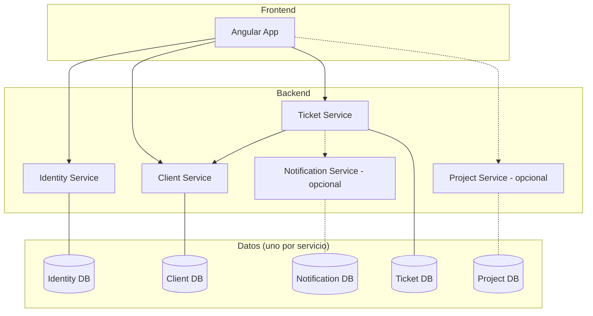

# Visión general de la arquitectura

> **Estado:** diseño planificado. Ningún componente está implementado todavía.

## 1. Arquitectura de microservicios

ST ServiceHub se compone de servicios pequeños, cada uno alineado con **un dominio de negocio**:

| Servicio | Dominio | Carácter |
|----------|---------|----------|
| Identity Service | Identidad, autenticación, roles y permisos | Obligatorio |
| Client Service | Clientes | Obligatorio |
| Ticket Service | Tickets, estados, prioridades, asignaciones, comentarios | Obligatorio |
| Project Service | Proyectos | Opcional |
| Notification Service | Notificaciones | Opcional |

Cada servicio será una aplicación Spring Boot independiente, con su propio `pom.xml`, su propia base de
datos y su propio ciclo de construcción. Que todos convivan en un mismo repositorio
([ADR-0001](../decisions/ADR-0001-monorepo.md)) **no** los convierte en un monolito.

## 2. Separación frontend / backend

- El **frontend** (Angular) es una SPA que solo presenta datos y gestiona la interacción. No contiene
  reglas de negocio críticas ni decisiones de autorización.
- El **backend** (servicios) expone APIs REST, aplica las reglas de negocio, valida las entradas y
  decide quién puede hacer qué.
- El frontend consume los servicios exclusivamente a través de sus APIs públicas documentadas en
  [`docs/api`](../api/README.md).

## 3. Responsabilidades

Las responsabilidades detalladas, lo que cada servicio **no** debe hacer y sus dependencias están en
[service-boundaries.md](service-boundaries.md).

## 4. Comunicación REST

- La comunicación inicial es **REST síncrona sobre HTTP con JSON**.
- Cada API se describe con **OpenAPI** antes o junto con su implementación (*contract-first* recomendado).
- Las llamadas entre servicios deben ser pocas, explícitas y documentadas. Si un servicio necesita un
  dato de otro, lo pide por API o guarda una referencia (p. ej. `clientId`), nunca lee su tabla.
- Los errores siguen un formato común (por definir; se recomienda *Problem Details*, RFC 9457).
- **API Gateway:** no forma parte del diseño inicial. El frontend llama directamente a cada servicio.
  Si en el futuro se necesita un punto de entrada único (CORS, enrutamiento, autenticación centralizada),
  se justificará mediante un ADR.
- La comunicación asíncrona (mensajería) queda fuera del alcance inicial.

## 5. Propiedad de datos

- **Cada servicio es el único dueño de sus datos** y el único que lee y escribe en su base de datos.
- Ningún servicio accede a tablas de otro servicio, ni siquiera para leer.
- Las relaciones entre dominios se modelan con **identificadores**, no con claves foráneas entre bases
  de datos.
- Ver la justificación en [service-boundaries.md](service-boundaries.md#por-qué-un-servicio-no-accede-a-la-base-de-datos-de-otro).

## 6. Seguridad

- **Identity Service** autentica a los usuarios y emite un token (mecanismo concreto pendiente de
  decisión, p. ej. JWT firmado).
- El frontend envía ese token en cada petición (`Authorization: Bearer ...`).
- **Cada servicio valida el token y aplica su propia autorización** (roles y propiedad de recursos).
  No existe la "red de confianza": un servicio no asume que una petición es legítima por venir de dentro.
- Validación de entradas con Bean Validation, secretos por variables de entorno y política de datos
  de prueba ficticios. Ver [SECURITY.md](../../SECURITY.md).

## 7. Despliegue independiente

- Cada servicio se construye, prueba y empaqueta (imagen Docker) **por separado**.
- Un cambio en un servicio no obliga a reconstruir ni redesplegar los demás, siempre que su contrato
  sea compatible.
- La CI ejecutará pipelines por servicio, activados por cambios en su directorio
  ([`infrastructure/jenkins`](../../infrastructure/jenkins/README.md)).
- Docker Compose se usará solo para levantar el conjunto en local
  ([`infrastructure/compose`](../../infrastructure/compose/README.md)).

## Decisiones pendientes

Análisis completo con alternativas y recomendaciones en
[technical-decisions-pending.md](technical-decisions-pending.md).

- Versiones de Java, Spring Boot, Angular y Node.js.
- Motor de base de datos relacional.
- Mecanismo de autenticación/token.
- Formato estándar de errores.
- Necesidad de API Gateway.
