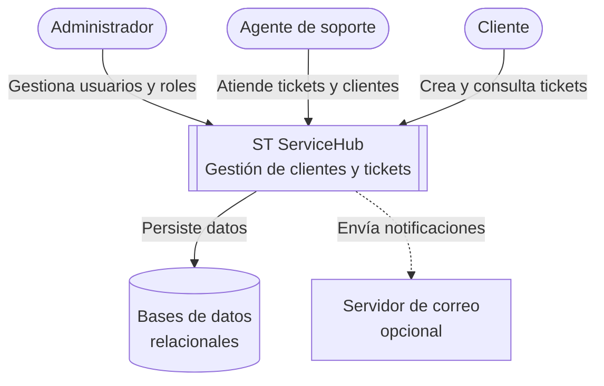

# Contexto del sistema

> **Estado:** diseño planificado.

Este documento muestra ST ServiceHub como una **caja negra**: quién lo usa y con qué sistemas externos
se relaciona. El detalle interno está en [overview.md](overview.md).

## Actores

> Los roles definitivos se confirmarán en la especificación de Identity Service.

| Actor | Descripción | Interacciones principales |
|-------|-------------|---------------------------|
| **Administrador** | Gestiona la plataforma. | Gestiona usuarios, roles y catálogos. |
| **Agente de soporte** | Personal de la organización que atiende tickets. | Consulta, actualiza y comenta tickets asignados; gestiona clientes. |
| **Cliente** | Persona de una organización cliente que solicita servicios. | Crea tickets y consulta el estado de los suyos. |

## Sistema

**ST ServiceHub:** plataforma web para registrar clientes y gestionar tickets de soporte con control de
acceso por roles. Opcionalmente gestiona proyectos y notificaciones.

## Dependencias externas

| Dependencia | Propósito | Estado |
|-------------|-----------|--------|
| Navegador web | Ejecuta la aplicación Angular. | Necesaria |
| Bases de datos relacionales | Persistencia, una por servicio (motor pendiente). | Necesaria |
| Servidor de correo (SMTP) | Envío de notificaciones. | Solo si se implementa Notification Service. Usar un servidor de pruebas local; nunca correos reales. |
| GitHub | Código, Issues, Pull Requests. | Herramienta de desarrollo |
| Jenkins | Integración continua. | Herramienta de desarrollo |

No se prevén integraciones con sistemas de terceros (pagos, CRM, proveedores de identidad externos) en
el alcance del curso.

## Diagrama de contexto

